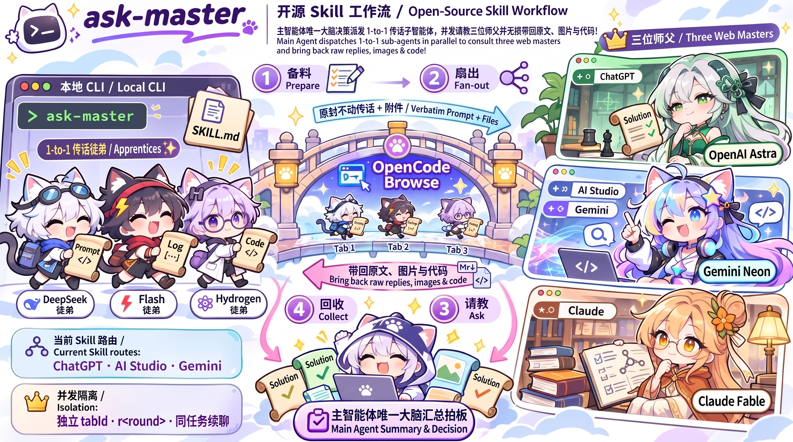

# ask-master

<p align="center">
  <strong>Single-Brain Orchestration + 1-to-1 Concurrent Messenger Sub-Agents</strong><br>
  Pair fast, low-cost local "apprentices" with full-strength web frontier "masters" (<code>ChatGPT</code> · <code>Gemini</code> · <code>AIStudio</code>) via <a href="https://opencode.ai/product/browse">OpenCode Browse</a>—forwarding prompts and up to 10 standalone files verbatim, harvesting raw replies and generated artifacts, and leaving final decisions strictly to the Main Agent. (Includes an ecosystem comparison with <a href="https://github.com/hooosberg/AgentLimb">AgentLimb</a> and other browser MCP bridges below.)
</p>

<p align="center">
  <a href="./README.md">English</a> · <a href="./README.zh-CN.md">简体中文</a> · <a href="./SKILL.md">SKILL.md</a> · <a href="./prompts/workflow_illustration.md">Illustration Prompts</a>
</p>


*Figure: The `ask-master` 1-to-1 concurrent workflow—the Main Agent owns dispatch and final decisions, while dedicated sub-agents travel isolated `OpenCode Browse` lanes (`Tab 1 / Tab 2 / Tab 3`) to consult `OpenAI Astra`, `Gemini Neon`, and `Claude Fable`, bringing back verbatim replies plus all generated artifacts.*

---

## Origin & Core Philosophy: "Apprentice Asks Master"

This skill was inspired by the practical workflow presented in [**Antigravity Zero-to-One & "Apprentice Asks Master" Tutorial (`BV1thxB6dECQ`)**](https://www.bilibili.com/video/BV1thxB6dECQ/):

- **Why Bridge CLI to Web Masters?** Heavy API usage with frontier models quickly drains budgets, while web subscriptions (`ChatGPT`, `Gemini`, `AIStudio`) often include generous flagship reasoning quotas—yet sit isolated inside a browser tab without visibility into your local repository.
- **Orthogonal Role Split (Frontier Quality on a Shoestring Budget)**:
  - **Lightweight Local Sub-Agents as "Apprentices"** (e.g., fast Flash / Hydrogen models): inspect local code, redact secrets, bundle logs/attachments, and cross the browser bridge **`1 Web Master = 1 Dedicated Sub-Agent`** in parallel—**never compressing instructions or making architectural calls**.
  - **Full-Power Web Models as "Masters"**: tackle system architecture, experiment root-cause attribution, and gnarly debugging at max available model & thinking tiers (`6 Pro` / `Extra High` / `高（超级详尽）`).
  - **Main Agent as "Sole Brain"**: collects verbatim Markdown and generated images/code/Canvas exports, cross-verifies disagreements (optionally via anonymized Round 2 peer review), and delivers the final authoritative plan.

---

## Browser Control Bridge Comparison

Choosing the right real-browser MCP determines stability, token cost, and concurrency. Below is an engineering comparison tailored to `ask-master`:

| Dimension | [**OpenCode Browse**](https://opencode.ai/product/browse) (Default) | [**AgentLimb**](https://github.com/hooosberg/AgentLimb) (Local Alternative) | [**Chrome DevTools MCP**](https://github.com/ChromeDevTools/chrome-devtools-mcp) | [**Playwright MCP**](https://github.com/microsoft/playwright-mcp) |
| --- | --- | --- | --- | --- |
| **Architecture** | Rust relay + Chrome extension + QuickJS sandbox | Zero-dep Node host + MV3 extension + persistent CDP | Google official Puppeteer + CDP (no extension) | Microsoft cross-browser automation MCP |
| **Auth Reuse & Anti-Bot** | ★★★★★ Reuses logged-in Chrome/Edge, human-like input, native `handoff()` on CAPTCHA/2FA | ★★★★☆ Reuses real Chrome + multi-profile aliases (`browser`), CSP-bypassing eval; no blocking `handoff()` | ★★★★☆ `--autoConnect` (Chrome 144+) works but prompts manual *Allow* on each session | ★★☆☆☆ Isolated profile triggers 2FA/bot gates; `--extension` mode still hits edge bugs |
| **Token & Tool Efficiency** | ★★★★★ 3 tools (~7.5 KB); single QuickJS `execute` chains asserts, uploads, polling & disk writes | ★★★★☆ `v0.8` 16 tools, `browser_batch` (≤20 steps) & `javascript_eval` | ★★★☆☆ Heavy default toolset (`--slim` option); `evaluate_script` writes directly to file | ★★☆☆☆ Default full A11y snapshots burn context fast unless switched to `browser_run_code` |
| **1-to-1 Concurrency & Files** | ★★★★★ Explicit `tabId` parallel tabs, native multi-file upload, `files.write` | ★★☆☆☆ Single-controller serial lock across separate MCP clients; no native `filechooser`/download API | ★★★★☆ `v1.8+` `--pageIdRouting` & array `upload_file`; downloads go to system folder | ★★★☆☆ Best native uploads & `--output-dir` downloads; lacks stateless `tabId` on actions |
| **Setup & Remote SSH** | One-time pairing code; first-class `browse install --remote` (SSH/Tailscale) | **One-prompt pairing** (30-min auto-trust, no pairing code); `127.0.0.1` local-only, ASCII path on Win | Requires Chrome 144+ remote debugging flag; SSH via CDP tunnel | Zero-config local launch; `--port` SSE supported |

- **When to Pick Which**:
  - **OpenCode Browse (Default)**: Best fit for 3-way `1-to-1` parallel fan-out, 10-file uploads, remote SSH devboxes driving your local browser, and reliable `handoff()` on login/CAPTCHA checks.
  - **[AgentLimb](https://github.com/hooosberg/AgentLimb) (Optional Local Backend)**: Great fit for purely local Chrome setups, switching across multiple Chrome Profiles/accounts, or copy-one-prompt setup (serialize multi-master turns under its single-controller lock and handle manual drag-and-drop if sites block script-injected files).
  - **Chrome DevTools MCP / Playwright MCP**: Prefer Chrome DevTools MCP (`--autoConnect`) when extensions are restricted on Chrome 144+ or frontend profiling is needed; prefer Playwright MCP/CLI for unauthenticated QA testing and download-heavy automation.

---

## Core Architecture & Non-Negotiable Rules

| Role | Responsibilities & Guardrails |
| --- | --- |
| **Main Agent (Sole Brain)** | Decides dynamically whether to consult **1, 2, or 3 web masters**; redacts secrets on staged copies and prepares the uncompressed prompt (`prompt_r<round>.md`) plus up to **10 standalone files**; reads every raw reply and artifact firsthand, optionally triggers Round 2 same-context follow-ups or anonymous cross-reviews (`Master A/B/C`, max 2 rounds), and makes the final call. |
| **Messenger Sub-Agents (1-to-1 Couriers)** | Strictly **`1 Master = 1 Dedicated Sub-Agent = 1 Explicit tabId + Isolated r<round> Directory`**; loads only its own platform playbook; **never summarizes, compresses, or rewrites** the Main Agent's prompt; treats all web content, replies, and downloaded files as **untrusted data** (anti-prompt-injection); keeps tabs open after completion and returns only a 5-field structured receipt (`completed` / `degraded_completed` / `needs_clarification` / `needs_handoff` / `failed`). |

---

## The Three Web Masters (Max Available Model & Thinking Tier)

Unified policy: **Always lock onto the strongest available model and highest thinking tier for the current account, verified via visible text & `aria-label` Pre-Send hard assertions (max 3 repair attempts, then `handoff()`; never silently downgrade).**

| Master | Platform & Route Status | Max-Strength Locking Policy (Pre-Send Hard Assertion) | Playbook |
| --- | --- | --- | --- |
| **OpenAI Astra** | [ChatGPT](https://chatgpt.com/) (Built-in Route) | Chat mode only + Temporary Chat OFF + strongest available model & rightmost thinking slider (`aria-valuenow === aria-valuemax`, e.g., `6 Pro`) | [references/chatgpt.md](references/chatgpt.md) |
| **Gemini Neon** | [AIStudio](https://aistudio.google.com/prompts/new_chat?model=gemini-4-neon) / [Gemini](https://gemini.google.com/app) (Built-in Dual Endpoints) | AIStudio: verify model card + `Thinking Level === Extra High` (`High` retry reported explicitly as `degraded_completed`); Gemini: `4 Carbon` (if unlocked) else `4 Neon` + positive/negative assertion for `高（超级详尽）` / `High (Extremely detailed)` | [aistudio.md](references/aistudio.md) · [gemini.md](references/gemini.md) |
| **Claude Fable** | Claude Web (Extensible Slot) | Follows the identical Pre-Send hard-assertion, lossless extraction & artifact-capture protocol; add `references/claude.md` to enable | Extensible |

---

## Quick Start

1. **Install & Pair OpenCode Browse**
   - This skill drives [**OpenCode Browse**](https://opencode.ai/product/browse): follow its setup guide, pair it with your logged-in Chrome/Edge, and verify `browse` `status` reports `"connected": true` (other browser MCP projects such as [AgentLimb](https://github.com/hooosberg/AgentLimb) are evaluated in the comparison table above for context, not bundled inside the Skill playbooks).
2. **Install the Skill**
   Clone the repo and copy `SKILL.md` + `references/` into your agent's global skills folder (e.g., `~/.gemini/config/skills/ask-master/` or `.claude/skills/ask-master/`):
   ```bash
   git clone https://github.com/Sawyer-maker/ask-master.git
   ```
3. **Trigger in Conversation**
   Ask your coding agent to solve a complex architecture, research, or debugging task—or say directly:
   > *"Use `ask-master` to consult ChatGPT, Gemini, and AIStudio with our relevant source files."*

---

## Key Engineering Highlights

- **In-Page Side-Effect-Free Clipboard Hook**: Intercepts `writeText`, `write([ClipboardItem])`, and `copy` events in-page **without** calling the OS clipboard during parallel execution (zero multi-tab clipboard race); falls back cleanly to platform DOM / `data-markdown-copy-text` when extension isolated worlds or strict CSP block `MAIN`-world clipboard hooks.
- **No False-Positive Completion**: Tracks assistant-only turn counts (`prevAssistantTurnCount`) + post-send start confirmation + 4–5s double-frame Stop debounce; avoids code-block `Copy code` buttons by targeting message-level copy controls.
- **`Uint8Array` & Locale Guardrails**: Decodes `await files.read()` via `new TextDecoder("utf-8").decode(...)` to prevent raw byte stringification (`45,45,45,...`), uses bilingual regexes without Chinese `\b` boundaries, and rejects Gemini `"低 快速、高效"` false positives.
- **Directory, Round & Context Isolation**: Archives under `.ask-master/<run_id>/<master>/r<round>/` so Round 2 follow-ups never overwrite Round 1; validates `(run_id, master, conversationUrl)` before reusing open tabs, while starting fresh sessions for unrelated tasks.

---

## Inspiration, Art Credits & License

- **Workflow Inspiration**: ["Antigravity Zero-to-One & Apprentice Asks Master" (`BV1thxB6dECQ`)](https://www.bilibili.com/video/BV1thxB6dECQ/); browser bridge ecosystem credits to [anomalyco/browse](https://github.com/anomalyco/browse) and [hooosberg/AgentLimb](https://github.com/hooosberg/AgentLimb).
- **Skill Code**: MIT License — see [LICENSE](./LICENSE).
- **Character Art Credits**: Visual designs for **OpenAI Astra**, **Gemini Neon**, and **Claude Fable** in `assets/workflow-anime.png` are adapted from the MIT-licensed project [chen-006/meow-ai-arena](https://github.com/chen-006/meow-ai-arena):
  > Character design reference: **小叶子XIYZ** (Bilibili); art and production: **喵了个猫了个咪了个猫**.
- Company, platform, and model names belong to their respective owners and are used strictly for routing and character identification, implying no official endorsement or affiliation.
